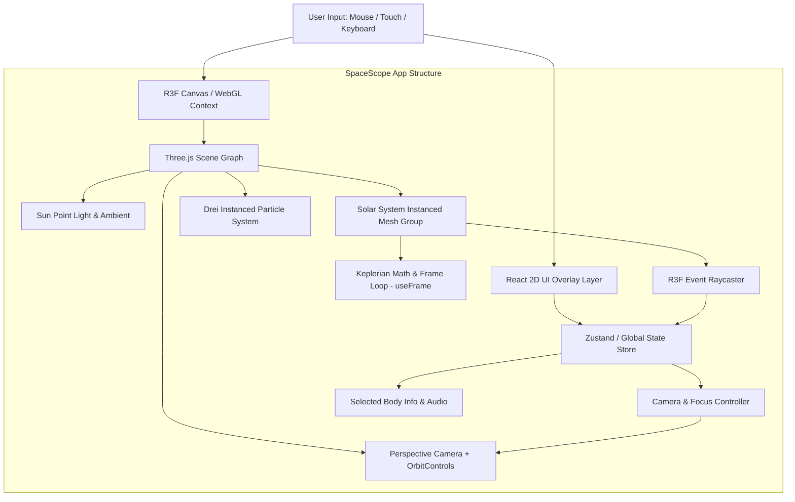

# SpaceScope — Technical Design Document (Phase 0)

## 1. What Problem SpaceScope Solves

SpaceScope is an educational, interactive 3D solar system exploration web application. Traditional astronomy tools and web pages either rely on flat 2D images with static diagrams or overly complex desktop software with steep learning curves. 

SpaceScope solves two main problems:
- **For Users & Learners:** Provides an engaging, visually rich, interactive 3D model of the solar system in the browser—allowing users to explore planet scales, orbits, axial tilts, and planetary statistics dynamically.
- **For Frontend Developers:** Serves as a practical blueprint for mastering 3D web graphics, bridging the gap between standard 2D web development and modern 3D technology stacks (**Three.js**, **React Three Fiber**, **Drei**, **WebGL**, 3D vector math, shaders, animation loops, and GPU performance optimization).

---

## 2. Why Normal HTML/CSS UI Is Not Enough for the Visualization

Standard HTML and CSS are built around the **2D DOM box model** (rectangular blocks arranged in document flow). While CSS 3D transforms (`transform: rotateX() translateZ()`) exist, they are fundamentally inadequate for real 3D solar system visualizations due to:

1. **Lack of True Depth Sorting & Intersections:** CSS relies on stacking contexts (`z-index`) and DOM ordering. When 3D objects intersect or orbit behind each other in 3D space, standard HTML elements cannot perform pixel-accurate depth buffering ($z$-buffering).
2. **Absence of Real Lighting & Shading:** HTML/CSS elements cannot calculate real-time lighting physics (diffuse, specular highlights, normal maps, shadows cast by a central star onto orbiting planets).
3. **No Polygon Mesh or Custom Shader Control:** CSS cannot render spherical geometries with custom surface topographies, atmospheric glows, or custom GPU fragment shaders.
4. **Performance Limits of DOM Nodes:** Managing hundreds of orbiting moons, asteroid fields, and starfield particles using DOM nodes leads to massive layout thrashing, DOM reflows, and unplayable frame rates. 3D graphics require hardware-accelerated GPU draw calls operating on raw vertex buffers.

---

## 3. What Three.js Does

**Three.js** is an open-source JavaScript library that simplifies working with 3D graphics in the browser. 

Without Three.js, developers would have to write thousands of lines of low-level WebGL boilerplate code to allocate GPU buffer memory, construct projection matrices, write custom GLSL shaders, and handle matrix multiplications. Three.js provides high-level abstractions like `Scene`, `PerspectiveCamera`, `Mesh`, `SphereGeometry`, `MeshStandardMaterial`, `DirectionalLight`, and `Raycaster`.

---

## 4. What WebGL Does

**WebGL (Web Graphics Library)** is the low-level JavaScript API integrated directly into modern web browsers. It provides direct access to the computer's Graphics Processing Unit (GPU) without requiring external plugins.

WebGL operates as a low-level state machine. It takes array buffers containing 3D coordinates, colors, and UV textures, and sends them to the GPU. On the GPU, small program pairs written in GLSL (OpenGL Shading Language)—called **Vertex Shaders** (which compute 3D point positions) and **Fragment Shaders** (which calculate pixel colors)—rasterize 3D geometry into 2D pixels on an HTML `<canvas>` element.

---

## 5. What React Three Fiber (R3F) Does

**React Three Fiber (R3F)** is a React renderer for Three.js. It allows developers to build 3D scenes declaratively using standard React components (`<mesh>`, `<sphereGeometry>`, `<ambientLight>`).

Key capabilities of R3F:
- **Declarative Scene Graphs:** Instead of imperatively calling `scene.add(mesh)` or `mesh.position.set(x, y, z)`, you write component structures with reactive props (`<mesh position={[x, y, z]}>`).
- **React Lifecycle Integration:** Standard React state, props, hooks, and context drive 3D object creation, unmounting, and prop updates smoothly.
- **Dedicated Render Loop (`useFrame`):** Provides a hook that executes on every browser animation frame (60-120 FPS), allowing smooth motion updates without triggering unnecessary React DOM re-renders.
- **Zero Performance Overhead:** R3F maps React elements directly to Three.js instances during initial creation and updates properties directly on the underlying 3D objects.

---

## 6. What Drei Does

**Drei** (German for "three") is an official helper library for React Three Fiber. It offers ready-to-use controls, abstractions, and visual effects that save hundreds of hours of manual configuration.

Key Drei features used in SpaceScope:
- `<OrbitControls>`: Enables intuitive camera panning, rotation, and zoom controls.
- `<Stars>` / `<Sparkles>`: Instantly renders thousands of performant background space particles.
- `<Html>`: Projects 2D HTML labels and UI overlays seamlessly onto 3D positions.
- `useGLTF`: Simplifies loading and caching optimized 3D models (GLTF/GLB formats).
- `<Environment>`: Provides HDR environment map lighting and reflections.

---

## 7. How a 3D Scene Differs from a Normal React Component Tree

| Feature | Standard React DOM Tree | 3D Scene Graph (R3F / Three.js) |
| :--- | :--- | :--- |
| **Output** | HTML elements (`<div>`, `<h1>`) rendered to a 2D document flow | 3D transformation matrix graph rendered to GPU pixel buffers |
| **Coordinate System** | 2D Pixel / Viewport Space ($X$ right, $Y$ down) | 3D Spatial Vector Space ($X$ right, $Y$ up, $Z$ forward/back) |
| **Updates** | State change $\rightarrow$ Virtual DOM diff $\rightarrow$ DOM reflow/repaint | Continuous render loop tick (`requestAnimationFrame`) running at 60+ FPS |
| **Layout Rules** | CSS Flexbox, Grid, Box Model | World Space Matrices, Parent-Child hierarchical transforms |
| **Z-Ordering** | CSS `z-index` stacking context | Depth Buffer ($z$-buffer) hardware depth testing per pixel |

---

## 8. Core 3D Concepts Explained

1. **Scene:** The root container (3D universe) holding all visible objects, lights, cameras, and audio helpers.
2. **Camera:** The viewpoint through which the scene is rendered. A `PerspectiveCamera` simulates human vision (objects further away appear smaller based on Field of View and frustum clipping planes).
3. **Geometry:** The structural shape/skeleton of a 3D object, defined by mathematical 3D point positions (**vertices**), connections (**edges**), and polygonal surfaces (**faces**).
4. **Material:** The surface visual property defining how light interacts with the geometry (color, roughness, metallic response, opacity, bump/normal maps, textures).
5. **Mesh:** The complete 3D object placed into the scene, formed by pairing a **Geometry** (shape) with a **Material** (skin).
6. **Light:** Photometric energy sources (e.g., `PointLight`, `DirectionalLight`, `AmbientLight`) placed in the scene to cast illumination, reflections, and shadows onto materials.

---

## 9. How User Interaction with 3D Objects Works

In a 2D DOM, clicking an element uses native browser event propagation. In 3D space, clicking requires **Raycasting**:

1. **Cursor Coordinate Conversion:** The 2D screen click position $(x, y)$ is converted into Normalized Device Coordinates (NDC), ranging from $-1.0$ to $+1.0$ across both axes.
2. **Ray Projection:** A mathematical ray (line vector starting at the camera lens) is projected out into 3D scene space toward the converted NDC point.
3. **Intersection Testing:** Three.js tests this ray against geometry bounding boxes and polygons in the scene graph to detect which mesh the ray intersects first.
4. **R3F Event Binding:** R3F wraps raycasting into clean React event handlers directly on `<mesh>` elements:
   ```jsx
   <mesh 
     onClick={(e) => selectPlanet(e.object.name)}
     onPointerOver={(e) => setHovered(true)}
     onPointerOut={(e) => setHovered(false)}
   />
   ```

---

## 10. Main Technical Risks & Mitigations

### A. Performance & Frame Rates
- **Risk:** High polygon counts, unthrottled shadow maps, and multiple dynamic lights cause frame drops below 60 FPS on integrated GPUs.
- **Mitigation:** Use instanced rendering for particle/asteroid fields, cap device pixel ratio (DPR) to `[1, 2]`, bake static lighting into environment maps, reuse geometries/materials, and update positions inside `useFrame` directly without triggering React re-renders.

### B. Mobile Rendering Constraints
- **Risk:** Mobile devices have lower GPU memory (VRAM), aggressive thermal throttling, and varied touch inputs.
- **Mitigation:** Implement resolution scaling, downsample textures for mobile viewports, simplify gesture controls (touch orbit/pinch zoom), and provide quality settings toggles.

### C. Asset Size & Load Times
- **Risk:** Uncompressed 8K planet textures and heavy 3D GLTF models lead to slow page loads and high memory usage.
- **Mitigation:** Compress textures using KTX2 / WebP formats, use Draco-compressed GLTF models, and implement progressive loading with React `<Suspense>` fallbacks.

### D. Animation & Orbit Complexity
- **Risk:** Stuttering orbits, unrealistic speeds, frame-rate dependent motion (faster on 140Hz displays than 60Hz displays), and jarring camera jumps when switching targets.
- **Mitigation:** Base orbital motion on delta time (`state.clock.getDelta()`), calculate Keplerian orbital positions smoothly, and use smooth interpolation helpers (`damp3`, `dampE`) for camera target transitions.

### E. Accessibility (a11y) & Motion Sensitivity
- **Risk:** WebGL `<canvas>` elements are invisible to screen readers, lack keyboard navigation focus states, and continuous rotation can trigger motion sickness.
- **Mitigation:** Provide an alternative 2D accessible UI drawer/data table, ensure full keyboard navigation support for selecting celestial bodies, implement visual focus rings in screen-space, and respect the user's `prefers-reduced-motion` system setting.

---

## Architecture Overview



---

## Learning Checklist

Before starting Phase 1, ensure mastery of the following key concepts:

- [ ] **WebGL Foundations:** Understand vertex shaders, fragment shaders, vector spaces (World, View, Projection), and GPU rasterization.
- [ ] **Three.js Core:** Master `Scene`, `Camera`, `Mesh`, `Geometry`, `Material`, `Light`, and `Raycaster`.
- [ ] **React Three Fiber (R3F):** Understand declarative mesh components, prop bindings, R3F canvas setup, `useFrame`, `useThree`, and event handlers.
- [ ] **Drei Helpers:** Practice using `<OrbitControls>`, `<Stars>`, `<Html>`, and `useGLTF`.
- [ ] **3D Math Essentials:** Understand vectors (`Vector3`), Euler rotations, quaternions, trigonometric rotation math ($\sin/\cos$ for orbits), and delta-time normalization.
- [ ] **Performance Principles:** Understand Draw Calls, Geometries/Materials reuse, Instancing, DPR scaling, and Asset optimization.

---

## Self-Evaluation Questions (Before Phase 1)

Answer these questions before writing Phase 1 code:

1. **Why does calling `setState` inside a 60 FPS `useFrame` hook degrade performance, and what should be done instead?**
2. **What is the difference between `MeshBasicMaterial`, `MeshStandardMaterial`, and `MeshPhysicalMaterial` regarding light calculations?**
3. **How does a perspective camera's Field of View (FOV) and Near/Far clipping plane affect what objects are rendered?**
4. **How do you convert 2D mouse cursor screen coordinates into 3D world coordinates for raycasting?**
5. **What is the purpose of multiplying movement speed by `delta` time inside an animation frame loop?**
6. **Why is Draco compression used for 3D GLTF models in web applications?**

---
*SpaceScope Phase 0 Technical Design Document complete.*
