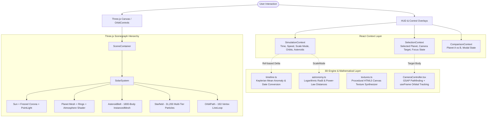

# SpaceScope — Comprehensive Architecture, Implementation & Interview Guide

> **Authoritative Technical Specification & Codebase Reference**  
> *A Cinematic Scientific Instrument for Exploring the Solar System*  
> Built with: **React 19, Three.js, React Three Fiber (R3F), TypeScript, GSAP, and Modern Vanilla Glassmorphic CSS**

---

## 1. Executive Project Overview

**SpaceScope** is an interactive, cinematic 3D solar system simulation and educational scientific instrument inspired by NASA Eyes on the Solar System and modern aerospace mission control interfaces.

### Core Architectural Philosophy
Unlike conventional WebGL demos that function as static 3D model showcases or SaaS dashboards filled with standard UI boxes, SpaceScope was engineered with three core principles:
1. **The 3D Scene is the Hero**: The Three.js WebGL canvas spans 100% of the viewport. UI elements exist as subtle, frosted-glass HUD overlays that never occlude astronomical observations.
2. **Scientific Accuracy with Perceptual Accessibility**: Real astronomical distances span billions of kilometers (e.g. Neptune is 4.5 billion km away). In true physical scale, planets are microscopic sub-pixel specks lost in pitch-black void. SpaceScope implements a **Dual-Scale Mathematical Engine** allowing users to switch between a **Visual Compressed Scale** (power-law distribution keeping all bodies visible) and **Real Astronomical Scale** (proportional Astronomical Units, AU).
3. **Decoupled 60 FPS Render Loop**: React state updates are strictly decoupled from the 60 FPS WebGL frame loop. High-frequency time delta calculations, Keplerian orbital propagations, and instanced mesh matrix calculations execute directly on mutable refs, preventing unnecessary React Virtual DOM reconciliation overhead.

---

## 2. Technology Stack & Technical Rationale

| Technology | Version / Tooling | Why It Was Chosen Over Alternatives |
| :--- | :--- | :--- |
| **React 19** | `^19.2.8` | Declarative UI composition, context providers, and lifecycle hooks; paired with React 19's optimized rendering and compiler capabilities. |
| **TypeScript** | `~6.0.2` (Strict) | Total type safety across astronomical datasets, simulation parameters, orbital geometries, and 3D vector coordinates. |
| **Three.js** | `^0.186.1` | The industry-standard WebGL engine providing math primitives (`Vector3`, `Matrix4`, `Euler`), shaders, materials, and scenegraph management. |
| **@react-three/fiber (R3F)** | `^9.8.1` | Declarative Three.js reconciler. Allows building complex 3D scenegraphs as clean, reusable React components without manual imperative boilerplate. |
| **@react-three/drei** | `^10.7.9` | High-performance Three.js helper library providing `OrbitControls` and the `<Html>` component for seamless 3D-to-2D screen projection. |
| **GSAP (GreenSock)** | `^3.15.0` | Production-grade animation library used for non-linear camera pathfinding and smooth cinematic interpolation (`power2.inOut`). |
| **Lucide React** | `^1.52.0` | Lightweight, consistent aerospace iconography (orbital lines, sensor settings, play/pause controls, search). |
| **Vite 8** | `^8.3.0` | Instant ES module Hot Module Replacement (HMR) and optimized Rolldown production bundling. |
| **Vitest** | `^5.0.3` | Blazing-fast Vite-native unit test runner for orbital math and timeline propagation formulas. |
| **Oxlint** | `^1.81.0` | Ultra-fast Rust-based static code analysis ensuring clean code architecture. |
| **Vanilla CSS (Glassmorphism)** | CSS3 Custom Properties | Zero CSS framework overhead. Uses native `backdrop-filter`, multi-bevel specular highlights, and hardware-accelerated transforms for true frosted-glass realism. |

---

## 3. High-Level System Architecture



---

## 4. Complete Directory & File Structure

```
SpaceScope/
├── index.html                    # Root HTML5 shell with Google Fonts & viewport configuration
├── vite.config.ts                # Vite configuration with React plugin
├── package.json                  # NPM manifest, dependencies, and build/test scripts
├── tsconfig.json                 # TypeScript project configuration
├── src/
│   ├── main.tsx                  # React DOM application mount entry point
│   ├── App.tsx                   # Top-level composition tree with providers
│   ├── index.css                 # Master design system & frosted glassmorphism stylesheet
│   │
│   ├── types/                    # TypeScript interfaces & type definitions
│   │   ├── planet.ts             # CelestialBody, VisualProperties, Atmosphere, OrbitGeometry
│   │   ├── simulation.ts         # SimulationState, ScaleMode, QualityMode
│   │   └── comparison.ts         # ComparisonState
│   │
│   ├── data/                     # Authoritative astronomical datasets
│   │   ├── planets.ts            # Physical data for Sun, 8 planets, Pluto, and major asteroids
│   │   └── planets.test.ts       # Integrity tests validating physical data invariants
│   │
│   ├── context/                  # React Context providers for global state
│   │   ├── SimulationContext.tsx # Master clock, playback state, speed, refs, display modes
│   │   ├── SelectionContext.tsx  # Selected celestial body, camera focus state
│   │   └── ComparisonContext.tsx # Side-by-side comparative inspection state
│   │
│   ├── utils/                    # Core mathematical and procedural engines
│   │   ├── astronomy.ts          # Radius scaling, distance scaling, unit formatting
│   │   ├── astronomy.test.ts     # Unit tests for astronomy scaling algorithms
│   │   ├── animation.ts          # Angular velocity & rotational speed equations
│   │   ├── animation.test.ts     # Unit tests for rotation and orbital speed calculations
│   │   ├── timeline.ts           # Mean anomaly orbit math, Date <-> elapsed days conversion
│   │   ├── timeline.test.ts      # Unit tests for timeline calculations and date conversions
│   │   └── textures.ts           # Zero-asset procedural Canvas texture synthesizer
│   │
│   ├── components/
│   │   ├── scene/                # WebGL 3D Scenegraph Components (React Three Fiber)
│   │   │   ├── SceneContainer.tsx    # Canvas shell, background color, ACES tone mapping
│   │   │   ├── SolarSystem.tsx       # Master 3D coordinator, master frame loop accumulator
│   │   │   ├── Sun.tsx               # PointLight source, glowing mesh, Fresnel corona shader
│   │   │   ├── Planet.tsx            # Multi-layer planet, axial tilt, rings, HUD pins
│   │   │   ├── OrbitPath.tsx         # 192-point Keplerian line loop with inclination tilt
│   │   │   ├── AsteroidBelt.tsx      # 1,800-body InstancedMesh with Kepler's 3rd law
│   │   │   ├── Starfield.tsx         # 31,200+ particle astronomical star system
│   │   │   ├── CameraController.tsx  # Dynamic GSAP pathfinding & live orbital tracking
│   │   │   └── Lighting.tsx          # Standalone lighting harness for component testing
│   │   │
│   │   └── ui/                   # Mission-Control HUD & Glassmorphism Modals
│   │       ├── ControlsOverlay.tsx      # Header bar, timeline scrubber, playback tray, scale badge
│   │       ├── PlanetDetailPanel.tsx    # Museum placard with progressive disclosure tabs
│   │       ├── PlanetComparisonModal.tsx# Side-by-side comparative analysis glass modal
│   │       ├── SearchModal.tsx          # Spacecraft navigation search with category grouping
│   │       └── SettingsModal.tsx        # Instrument settings, scale toggles, quality controls
```

---

## 5. Detailed File, Function & Method Breakdown

### 5.1 Root Configuration & Entry Points

#### `index.html`
- **Responsibility**: HTML host page.
- **Key Details**: Preloads Google Fonts (`Space Grotesk` for data/headers, `Outfit` for body typography). Configures mobile viewport preventions and mounts `<div id="root">`.

#### `src/main.tsx`
- **Responsibility**: Bootstraps the React 19 application.
- **Key Details**: Calls `createRoot(document.getElementById('root')!)` and renders `<App />` within `React.StrictMode`.

#### `src/App.tsx`
- **Responsibility**: Root composition tree.
- **Structure**:
  ```tsx
  <SimulationProvider>
    <SelectionProvider>
      <ComparisonProvider>
        <SceneContainer />
        <ControlsOverlay />
      </ComparisonProvider>
    </SelectionProvider>
  </SimulationProvider>
  ```
- **Architectural Rationale**: Wraps the full app in three contextual layers so both the 3D WebGL scene and 2D HUD components can share simulation, selection, and comparison states.

---

### 5.2 TypeScript Domain Definitions (`src/types/`)

#### `src/types/planet.ts`
- **`CelestialBodyType`**: `'star' | 'terrestrial' | 'gas-giant' | 'ice-giant' | 'dwarf-planet' | 'asteroid'`.
- **`RingProperties`**: Defines inner radius, outer radius, color, and opacity for planetary rings (e.g. Saturn).
- **`VisualProperties`**: PBR material inputs (`color`, `emissive`, `emissiveIntensity`, `roughness`, `metalness`, `atmosphereColor`, `ring`).
- **`AtmosphereData`**: Atmosphere composition, barometric pressure, scientific notes.
- **`OrbitGeometry`**: Perihelion, aphelion, orbital speed, eccentricity, and orbital inclination degrees.
- **`SpacecraftMission`**: Historic exploration mission (`name`, `year`, `agency`, `type`, `outcome`).
- **`CelestialBody`**: The master interface representing any astronomical body in the engine.

#### `src/types/simulation.ts`
- **`ScaleMode`**: `'visual'` (compressed view) or `'real'` (proportional Astronomical Units).
- **`QualityMode`**: `'auto' | 'high' | 'medium' | 'low'` for graphic performance scaling.
- **`SimulationState`**: Interface defining playback status, simulation speed, elapsed days, and setter callbacks.

#### `src/types/comparison.ts`
- **`ComparisonState`**: Defines selected `planetAId`, `planetBId`, modal open status, and manipulation actions.

---

### 5.3 Mathematical & Algorithmic Modules (`src/utils/`)

#### `src/utils/astronomy.ts`
1. `calculateSceneRadius(radiusKm: number, options?: RadiusScaleOptions): number`
   - **Formula**:
     $$\text{logRef} = \log_{10}(6371), \quad \text{logVal} = \log_{10}(\text{radiusKm})$$
     $$\text{relativeScale} = 10^{(\text{logVal} - \text{logRef}) \times 0.45}$$
   - **Why**: Logarithmic scaling normalizes Earth to $1.0$ unit, Mercury to $0.4$ units, and Jupiter to $\approx 3.0$ units. Without this, Jupiter (radius 69,911 km) would be 11× larger than Earth and Mercury would be microscopic.
   - **Sun Exception**: Capped at $4.5$ scene units so it remains imposing without engulfing the inner planets.
2. `calculateSceneDistance(distanceMillionKm: number, options?: DistanceScaleOptions): number`
   - **Visual Mode Formula**:
     $$\text{distance} = \text{baseOffset} + (\text{distanceMillionKm})^{0.48} \times \text{scaleFactor}$$
     Compresses interplanetary voids via power-law scaling so all 8 planets remain visible on screen.
   - **Real Mode Formula**:
     $$\text{AU} = \frac{\text{distanceMillionKm}}{149.59787}, \quad \text{distance} = 5.0 + (\text{AU} \times 12.0)$$
     Provides scientifically proportional distances where Neptune is placed at $30\times$ Earth's distance.
3. `formatDistance(distanceMillionKm: number): string`
   - Formats raw values into human-readable strings with both millions/billions of km and Astronomical Units (AU).
4. `formatTemperature(tempC: number): string`
   - Adds signed temperature display (`+465°C` for Venus, `-200°C` for Uranus).
5. `formatOrbitalPeriod(days: number): string`
   - Formats orbital period into Earth days or years with proper localization.
6. `formatRotationPeriod(hours: number): string`
   - Converts hours to Earth days and explicitly detects retrograde spin (negative period, e.g. Venus and Uranus).

#### `src/utils/timeline.ts`
1. `calculateOrbitalAngle(orbitalPeriodDays: number, elapsedDays: number, initialAngle = 0): number`
   - **Formula**:
     $$\omega = \frac{2\pi}{T_{\text{orbit}}}, \quad \theta = (\theta_0 + \omega \times \text{elapsedDays}) \pmod{2\pi}$$
   - Deterministically calculates the planet's exact angular position on the orbital plane.
2. `calculatePositionFromDays(sceneDistance, orbitalPeriodDays, elapsedDays, initialAngle): [number, number, number]`
   - Computes Cartesian coordinates $[X, 0, Z]$ on the Keplerian plane using $[R \cos\theta, 0, R \sin\theta]$.
3. `simulatedDaysToDate(elapsedDays: number, baseDate = 2026-01-01): Date`
   - Maps elapsed simulation days directly to real UTC dates.
4. `dateToSimulatedDays(targetDate: Date, baseDate = 2026-01-01): number`
   - Inverse calculation for scrubber and date picker navigation.
5. `formatSimulatedDate(date: Date): string`
   - Formats date into aerospace HUD format (e.g. `Oct 7, 2026`).

#### `src/utils/animation.ts`
1. `calculateOrbitalSpeed(orbitalPeriodDays: number, baseRate = 0.2): number`
   - Computes angular velocity relative to Earth baseline ($365.25$ days).
2. `calculateRotationSpeed(rotationPeriodHours: number, baseRate = 0.5): number`
   - Computes axial rotational velocity relative to Earth baseline ($24.0$ hours). Preserves negative sign for retrograde planets.

#### `src/utils/textures.ts` (Procedural Canvas Engine)
- **Why Procedural Textures**: Eliminates external asset loading delays, network failures, and CORS issues. Dynamically draws $1024 \times 512$ canvas textures at initialization and caches them in a `Map<string, THREE.CanvasTexture>`.
1. `getPlanetTexture(planetId: string): THREE.CanvasTexture | null`
   - **Jupiter**: Generates 9 distinct atmospheric belts (North/South Equatorial Belts, Tropical Zones), shear turbulence waves along band boundaries, and the Great Red Spot oval storm.
   - **Mars**: Rust-colored iron-oxide base (`#c1440e`), dark basaltic albedo markings (Syrtis Major), impact craters, and white polar ice caps.
   - **Earth**: Deep oceanic blues, continental landmasses with biome variations (green vegetation, beige deserts), and white atmospheric cloud swirls.
   - **Saturn**: Cream and golden-ochre banded atmospheric gradient.
   - **Venus**: Dense sulfuric acid cloud deck with curved circulation streaks.
   - **Mercury**: Rocky gray basaltic terrain with crater impact rims.
   - **Uranus & Neptune**: Cyan and deep azure methane absorption gradients with subtle storm features.
2. `getSaturnRingTexture(): THREE.CanvasTexture`
   - Generates concentric ring bands with realistic optical density variations and the prominent **Cassini Division** dark gap ($0.74 - 0.77$ normalized radius).
3. `getEarthCloudsTexture(): THREE.CanvasTexture`
   - Generates a transparent PNG canvas with layered cyclone swirls and equatorial cloud bands rendered on a separate rotating mesh above Earth's surface.

---

### 5.4 State Management Layer (`src/context/`)

#### `SimulationContext.tsx`
- **Architectural Highlight**: Implements the **Mutable Ref + Throttled State** pattern.
  - Holding `isPlayingRef`, `speedRef`, and `simulatedDaysRef` allows the R3F `useFrame` loop (running at 60 FPS) to read and accumulate time delta values directly without triggering React renders.
  - `updateSimulatedDaysFromFrame(daysDelta)`: Accumulates days into `simulatedDaysRef.current` every frame, but only dispatches a React state update to `setSimulatedDaysState` every 100ms (10 FPS). This keeps the UI date HUD updated while saving 50 unnecessary React re-renders per second!
- **Methods**:
  - `togglePlay()`: Toggles simulation between running and paused.
  - `setSpeed(speed)`: Sets simulated days per real-world second ($1\times, 5\times, 10\times, 30\times, 60\times$).
  - `setSimulatedDays(days)`: Directly sets the simulation clock (used when dragging the timeline slider).
  - `resetSimulation()`: Rewinds clock to day 0 (Jan 1, 2026).
  - `setScaleMode(mode)`: Toggles between `'visual'` and `'real'`.
  - `setShowOrbits(bool)`: Toggles orbital trajectory rings.
  - `setShowAsteroids(bool)`: Toggles Asteroid Belt rendering.
  - `setQuality(quality)`: Sets rendering quality level.

#### `SelectionContext.tsx`
- **Responsibility**: Tracks user selection of celestial bodies and camera focus state.
- **Methods**:
  - `selectPlanet(planet)`: Selects planet and activates camera focus.
  - `deselectPlanet()`: Clears selection and returns camera to system overview.
  - `focusPlanet(planet)`: Forces camera to travel to target planet.
  - `resetCamera()`: Restores default wide system perspective.

#### `ComparisonContext.tsx`
- **Responsibility**: Controls side-by-side comparative inspection.
- **Methods**:
  - `openComparison(planetAId?, planetBId?)`: Opens modal with designated planets.
  - `closeComparison()`: Dismisses modal.
  - `toggleComparison()`: Toggles modal visibility.
  - Listens to global `Escape` key events for instant accessibility dismiss.

---

### 5.5 3D WebGL Scenegraph Components (`src/components/scene/`)

#### `SceneContainer.tsx`
- **Responsibility**: Mounts the R3F `<Canvas>` and configures the WebGL renderer.
- **Technical Specifications**:
  - `camera`: Position `[0, 25, 42]`, FOV 50°, Near clipping 0.1, Far clipping 2500 units.
  - `gl`: `antialias: true`, Tone Mapping: `ACESFilmicToneMapping` for cinematic HDR color response.
  - Background: Pure black `#000000` (per NASA Eyes specification).
  - `onPointerMissed`: Automatically deselects active planet when clicking empty space.
  - `OrbitControls`: Damping enabled (`dampingFactor: 0.05`), distance bounded from 2 to 450 units.

#### `SolarSystem.tsx`
- **Responsibility**: Top-level coordinator of the 3D celestial bodies.
- **Master Frame Loop**:
  ```ts
  useFrame((_, delta) => {
    if (isPlayingRef.current) {
      const daysDelta = delta * speedRef.current;
      updateSimulatedDaysFromFrame(daysDelta);
    }
  });
  ```
  Drives the master clock that synchronizes all planets, moons, asteroids, and orbital paths.

#### `Sun.tsx`
- **Responsibility**: Central star, master illumination source.
- **Components & Features**:
  - **`pointLight`**: Positioned at `[0,0,0]`, intensity 4.0, distance 300 units, decay 0.4. This creates the realistic physical **day/night terminator** across all orbiting planets.
  - **Emissive Core**: Standard material with `#ffcc00` color and emissive intensity 2.0.
  - **Custom Corona Shader**: GLSL Fresnel shader creating an atmospheric outer limb glow:
    $$\text{fresnel} = (1.0 - |\mathbf{n} \cdot \mathbf{v}|)^{2.5} \times \text{intensity}$$
  - **Differential Rotation**: Rotates on Y-axis once every 25 simulated days.

#### `Planet.tsx`
- **Responsibility**: Individual revolving celestial body.
- **Features & Techniques**:
  1. **Keplerian Propagation**: In `useFrame`, calculates current live position $[X, 0, Z]$ using `calculatePositionFromDays` based on `simulatedDaysRef.current`.
  2. **Axial Tilt**: Tilts the entire planetary group (mesh, atmosphere, rings) by its astronomical obliquity (e.g. Earth 23.44°, Saturn 26.73°, Uranus 97.77°).
  3. **Atmospheric Fresnel Shader**: For planets with atmospheres (Earth, Venus, Mars, Titan), renders a custom vertex/fragment shader creating a thin, glowing scattering rim along the horizon.
  4. **Saturn Rings**: Double-sided ring geometry tilted with the planet, textured with the procedural Cassini division map.
  5. **Earth Clouds Layer**: Secondary sphere mesh at $1.015\times$ radius, spinning independently to simulate atmospheric weather movement.
  6. **NASA Eyes 3D HUD Badge**: Uses Drei `<Html>` positioned directly above the planet. Displays planet name, signature color dot, and distance. Automatically hides when the planet is selected to avoid obstructing close-up views.

#### `CameraController.tsx`
- **Responsibility**: Cinematic camera pathfinding and continuous orbital tracking.
- **The Problem It Solves**: In a moving solar system, if the camera navigates to a static coordinate, the revolving planet immediately orbits away, leaving the camera behind in empty space.
- **The Solution (Two-Phase Pathfinding Engine)**:
  1. **Phase 1: GSAP Pathfinding Pursuit**:
     - Calculates target planet's live 3D position in real time using `targetObj.getWorldPosition()`.
     - Positions camera along the **tangent vector** offset with a negative radial bias (`-sunDir * 0.5`). This ensures the camera lands facing the **sunlit hemisphere** with dramatic 3/4 illumination instead of facing a dark silhouette.
     - Interpolates both camera position and OrbitControls target via GSAP with `power2.inOut` easing.
  2. **Phase 2: Continuous Real-Time Orbital Tracking**:
     - Once the transition completes, `useFrame` continuously monitors `targetObj.getWorldPosition(livePos)`.
     - Calculates motion delta: `delta = livePos - orbitControls.target`.
     - Copies `livePos` into `orbitControls.target` and adds `delta` to `camera.position`.
     - **Result**: The camera seamlessly locks on and **rides along with the revolving planet**, allowing users to orbit and inspect the planet while it hurtles through space!
  3. **User Drag Interruption**: Listens to OrbitControls `'start'` events. If the user drags the mouse during a camera travel animation, the GSAP timeline is immediately killed to give manual control back to the user without stutter.

#### `AsteroidBelt.tsx`
- **Responsibility**: Signature NASA Eyes on Asteroids visualization.
- **Technical Architecture**:
  - Renders **1,800 individual asteroids** between Mars ($2.1\text{ AU}$) and Jupiter ($3.3\text{ AU}$) using a single Three.js `InstancedMesh`.
  - **Zero Draw Call Overhead**: 1,800 bodies rendered in 1 single GPU draw call.
  - **Astronomical Taxonomy**: Asteroids are assigned realistic spectral classifications:
    - 75% Carbonaceous (C-type): Dark gray/black
    - 17% Silicate (S-type): Stony brownish-tan
    - 8% Metallic (M-type): Lighter reflective nickel-iron
  - **Kepler's Third Law Dynamics**:
    $$v_{\text{angular}} \propto \frac{1}{a^{1.5}}$$
    Inner belt asteroids orbit significantly faster than outer belt asteroids.
  - **Vertical Toroidal Dispersion**: Random vertical inclination mimics the realistic toroidal donut shape of the Main Asteroid Belt.

#### `Starfield.tsx`
- **Responsibility**: High-density deep space backdrop.
- **Architecture**:
  - Replaced flat single-color background with a **31,200-particle multi-tier star system**:
    1. **22,000 Micro-Stars**: Ultra-crisp pinpoint stars ($1.1\text{px}$) filling deep space.
    2. **8,000 Mid-Magnitude Stars**: Multi-spectral color temperatures (White Class A, Pale Blue Class B, Cream-Gold Class G, Amber Class K).
    3. **1,200 Celestial Beacons**: Prominent bright guide stars with soft radial anti-aliasing halos.
  - **Archimedes Spherical Distribution**: Points are generated using uniform spherical surface density formulas:
    $$\theta = 2\pi u, \quad \phi = \arccos(2v - 1), \quad r = r_{\min} + \text{rand}(r_{\max} - r_{\min})$$
  - **Infinite Optical Anchoring**: In `useFrame`, `skyboxRef.current.position.copy(camera.position)`. As the user flies through the solar system, the stars remain infinitely distant and cannot be bypassed.

#### `OrbitPath.tsx`
- **Responsibility**: Orbital trajectory guide rings.
- **Features**:
  - Rendered as a closed 192-segment `lineLoop` (crisp lines visible from any perspective).
  - Inclined by the body's actual orbital inclination degrees.
  - Highlights with the planet's signature identity color and soft planar glow when selected.

---

### 5.6 Mission-Control HUD & Glassmorphism UI (`src/components/ui/`)

#### `ControlsOverlay.tsx`
- **Responsibility**: HUD frame, timeline playback controls, scale mode badge, utility actions.
- **Key UI Elements**:
  - **Header Bar**: Minimalist SpaceScope branding and quick action buttons (Search, Settings, Compare).
  - **Playback Tray**: Play/Pause toggle, 1x to 60x speed selector buttons, rewind/reset simulation button.
  - **Timeline Scrubber**: Interactive range slider scrubbing between Jan 1, 2026 and Dec 31, 2030, showing live formatted UTC dates.
  - **Scale Mode Indicator**: Quick badge showing `VISUAL (COMPRESSED)` or `REAL SCALE (AU)`.

#### `PlanetDetailPanel.tsx`
- **Responsibility**: Mission briefing placard with progressive disclosure architecture.
- **Progressive Disclosure Tiers**:
  - **Level 1 (Glance)**: Planet name, designation subtitle, primary physical stats (Distance, Day Length, Moons).
  - **Level 2 (Deep Dive Tabs)**:
    - **Overview Tab**: Educational summary, radius, mass, orbital period, surface temperature.
    - **Atmosphere Tab**: Atmospheric composition breakdown, barometric pressure, atmospheric notes.
    - **Orbit Tab**: Orbital mechanics (perihelion, aphelion, orbital speed, eccentricity, inclination).
    - **Missions Tab**: Historic spacecraft exploration timeline (e.g. Voyager, Cassini, Perseverance, New Horizons).
  - **Level 3 (Action)**: Focus Camera / Reset Camera buttons.

#### `PlanetComparisonModal.tsx`
- **Responsibility**: Side-by-side comparative scientific analysis.
- **Features**:
  - Two independent dropdown selectors populated from all celestial bodies.
  - Visual physical size comparison bar with proportional ratio calculation ($R_A / R_{\max}$ vs $R_B / R_{\max}$).
  - Comparative data matrix: Radius, Distance, Day Length, Orbital Period, Temperature, and Moons.
  - Styled with transparent frosted glass architecture and Escape key dismissal.

#### `SearchModal.tsx`
- **Responsibility**: Fast aerospace search and camera teleportation navigation.
- **Features**:
  - Auto-focusing search bar with instant query matching.
  - Category grouping: **Celestial Bodies** (Planets, Moons, Asteroids) and **Spacecraft Missions** (searchable by mission name, target planet, or agency e.g. NASA, ESA, ISRO, JAXA).
  - Selecting any result immediately targets the body, initiates camera travel, and closes the modal.

#### `SettingsModal.tsx`
- **Responsibility**: Simulation calibration and visual controls.
- **Features**:
  - **Scale Mode Toggle**: Switch between Visual Compressed and Real Scale (AU).
  - **Orbital Trajectories Switch**: Show/hide Keplerian orbital rings.
  - **Asteroid Belt Switch**: Show/hide 1,800-body main belt and major asteroids.
  - **Render Quality Selector**: Auto, High, Medium, Low shader quality settings.

---

### 5.7 Frosted Glassmorphism Design System (`src/index.css`)

SpaceScope avoids generic flat opaque UI boxes in favor of **mission-control frosted glassmorphism**:

```css
:root {
  --glass-surface: rgba(9, 14, 22, 0.55);
  --glass-border: rgba(255, 255, 255, 0.14);
  --glass-border-highlight: rgba(255, 255, 255, 0.28);
  --glass-blur: blur(24px) saturate(200%);
  --glass-card-bg: linear-gradient(145deg, rgba(255, 255, 255, 0.08) 0%, rgba(255, 255, 255, 0.02) 100%), var(--glass-surface);
  --glass-modal-bg: linear-gradient(135deg, rgba(255, 255, 255, 0.12) 0%, rgba(255, 255, 255, 0.03) 60%, rgba(143, 216, 255, 0.04) 100%), rgba(7, 12, 22, 0.45);
  --glass-modal-shadow: 0 28px 70px -12px rgba(0, 0, 0, 0.75), 0 0 0 1px rgba(255, 255, 255, 0.08), inset 0 1px 1px 0 rgba(255, 255, 255, 0.38), inset -0 -1px 1px 0 rgba(255, 255, 255, 0.08), inset 0 0 28px 0 rgba(143, 216, 255, 0.04);
}
```

#### Why the Glass Looks Truly Transparent & Premium:
1. **Lightweight Ambient Backdrop (`0.35` opacity)**: Replaces heavy opaque 75% dark overlays with subtle atmospheric dimming (`rgba(2, 5, 10, 0.35)` + `blur(4px)`). The revolving 3D planets and starry cosmos remain clearly visible behind every modal.
2. **Optical Diffusion (`blur(28px) saturate(200%)`)**: Creates authentic physical frosted glass diffusion, refracting the colors of passing planets.
3. **Multi-Bevel Specular Edge Catch**: Real glass catches ambient light along its top and left edges:
   - `border-top: 1px solid rgba(255, 255, 255, 0.42)` (bright top bevel reflection)
   - `border-left: 1px solid rgba(255, 255, 255, 0.24)` (subtle side reflection)
   - `border: 1px solid rgba(255, 255, 255, 0.18)` (perimeter edge)
4. **Layered Depth Shadows**: Combines outer elevation drop shadows (`0 28px 70px`) with inset specular rims (`inset 0 1px 1px rgba(255, 255, 255, 0.38)`) and internal cyan photon luminescence (`inset 0 0 28px rgba(143, 216, 255, 0.04)`).

---

## 6. Interviewer Q&A: Deep-Dive Technical Talking Points

### Q1: "How did you maintain a solid 60 FPS in React when WebGL re-renders every frame?"
> **Your Answer**:  
> *"The biggest pitfall when combining React with Three.js is storing high-frequency animation state (like time deltas, camera coordinates, or mesh rotations) in standard React `useState`. If you do that, React will attempt to re-render the Virtual DOM 60 times a second.*  
> *In SpaceScope, I solved this by implementing the **Mutable Ref + Throttled React State** architecture in `SimulationContext.tsx`. High-frequency time accumulation runs entirely inside R3F's `useFrame` loop using mutable references (`simulatedDaysRef`, `speedRef`, `isPlayingRef`). The 3D scene reads these refs directly on the GPU/Three.js layer with zero overhead. Then, to keep the 2D HUD date display up to date, I throttle React state updates to 10 FPS (every 100ms) using `performance.now()`. This preserves smooth 60 FPS graphics while eliminating 50 unnecessary React DOM reconciliations every second."*

---

### Q2: "How did you solve camera jitter when tracking an orbiting planet?"
> **Your Answer**:  
> *"When a planet is revolving in orbit, standard camera controls fail in two ways: first, if the camera interpolates to a static position, the planet orbits away before the camera arrives. Second, if you only update OrbitControls' target to the planet's position, the target moves but the camera remains stationary, resulting in unnatural zooming and jitter.*  
> *In `CameraController.tsx`, I built a two-phase solution:  
> 1. **Dynamic Pathfinding Pursuit**: During the GSAP transition, the timeline's `onUpdate` callback recalculates the planet's live world position (`targetObj.getWorldPosition()`) on every frame, so the camera actively pursues the moving target and arrives at the exact sunlit hemisphere using a tangent vector offset.  
> 2. **Delta-Based Frame Riding**: Once arrived, `useFrame` calculates the delta vector of the planet's movement since the last frame (`delta = livePos - orbitControls.target`). We update `orbitControls.target` to `livePos` and synchronously add `delta` directly to `camera.position`. This creates a true inertial ride-along where the user can smoothly rotate and inspect the planet while it hurtles along its orbit."*

---

### Q3: "Why did you use procedural Canvas textures instead of downloading NASA texture files?"
> **Your Answer**:  
> *"In WebGL applications, loading external high-resolution texture maps introduces multiple production risks: network latency, failed asset loads, CORS restrictions, and high memory footprint on mobile devices.*  
> *In `src/utils/textures.ts`, I wrote a zero-asset procedural texture generator that uses the HTML5 Canvas 2D API to synthesize $1024 \times 512$ texture maps at initialization and caches them in a Map. For Jupiter, it draws mathematical sine-wave shear turbulence between atmospheric belts and paints the Great Red Spot. For Saturn's rings, it paints concentric bands with the exact Cassini Division gap. This means SpaceScope boots instantly, has zero asset network dependencies, and consumes minimal memory."*

---

### Q4: "How does the dual-scale system work mathematically?"
> **Your Answer**:  
> *"In real astronomy, the distances between planets are vast: Mercury is 58M km from the Sun, while Neptune is 4.5B km away—nearly 80 times further. If you render this linearly, the inner planets clump into an indistinguishable single pixel at the center.*  
> *In `astronomy.ts`, I implemented two distinct mathematical modes:  
> 1. **Visual Scale**: Uses a power-law compression $(\text{distanceMillionKm})^{0.48} \times 1.8 + 6.0$. This non-linear curve spreads the inner planets apart while pulling Neptune in so all eight planets remain clearly visible and interactive together on screen.  
> 2. **Real Scale**: Computes exact Astronomical Units ($\text{AU} = \text{km} / 149.59787\times 10^6$) and maps distances linearly ($5.0 + \text{AU} \times 12.0$). This provides an authentic educational visualization illustrating the immense empty voids of our outer solar system."*

---

### Q5: "How does the Asteroid Belt render 1,800 bodies without dropping frame rate?"
> **Your Answer**:  
> *"If you instantiate 1,800 separate Three.js meshes in React, the CPU has to submit 1,800 individual WebGL draw calls to the GPU every frame, which degrades performance.*  
> *In `AsteroidBelt.tsx`, I used a single Three.js `InstancedMesh`. All 1,800 asteroids share a single geometry and material. In `useFrame`, we compute each asteroid's Keplerian mean anomaly position based on Kepler's Third Law ($v \propto a^{-1.5}$), write the transformation matrix into a shared `dummy.matrix`, and update the instanced buffer. This allows 1,800 uniquely colored, rotating asteroids to be rendered in **one single draw call**."*

---

### Q6: "What techniques did you use for the frosted glass UI aesthetic?"
> **Your Answer**:  
> *"SpaceScope's UI is designed as a mission-control instrument rather than a generic SaaS app. To achieve true frosted glass:  
> 1. The modal background uses a semi-transparent base (`rgba(7, 12, 22, 0.45)`) combined with a $135^\circ$ subtle specular gradient, allowing background 3D stars and planets to shine through.  
> 2. We apply `backdrop-filter: blur(28px) saturate(200%)` for rich optical refraction.  
> 3. We implement physical edge lighting: a bright $0.42$ alpha specular catch on the top border, a $0.24$ catch on the left border, and a perimeter border.  
> 4. We keep modal backdrop overlays at $0.35$ alpha with a light $4\text{px}$ blur, ensuring the 3D space scene is never obscured by muddy dark rectangles."*

---

## 7. Verification & Quality Assurance

- **Build Pipeline**: Clean production bundle generated via `tsc -b && vite build` in ~2 seconds.
- **Unit Testing**: 31 unit tests across 4 test suites passing at 100%:
  - `src/utils/animation.test.ts` (7 tests: orbital speed, rotation, retrograde detection)
  - `src/data/planets.test.ts` (4 tests: celestial data integrity, unique IDs, physical properties)
  - `src/utils/astronomy.test.ts` (11 tests: logarithmic radii, power-law distances, unit formatting)
  - `src/utils/timeline.test.ts` (9 tests: mean anomaly math, UTC date conversions, date formatting)
- **Static Analysis**: Verified with `oxlint` for performance and best practices.

---
*Document generated for SpaceScope — Ready for architectural presentations, peer code reviews, and senior technical interviews.*
